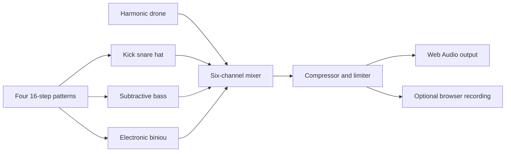

# Cyber-Fest-Noz — Groovebox EBM Breizh · Studio Niko Design

**Browser groovebox · Electronic reed synthesis · Pattern sequencer**

[Source audio](index.html) · [Licence](LICENSE.md) · [English overview](#english-overview)

## Architecture audio



| Module | Implémentation constatée dans index.html |
| --- | --- |
| Séquenceur | Tone.Sequence, quatre patterns A–D de 16 pas, enchaînement, swing |
| Kick / snare / hat | MembraneSynth, NoiseSynth, MetalSynth ; filtrage et distorsion |
| Basse | MonoSynth à dent de scie, filtre passe-bas, accents et slides |
| Biniou V3 | Deux oscillateurs à partiels personnalisés, formants, pression et souffle, ornements |
| Bourdon | Trois oscillateurs sinusoïdaux, modulation lente, filtre et saturation |
| Master | Six voies, mute/solo, compresseur, limiteur réglé à −1 dB |
| Projet | Historique borné à 60 éditions de patterns, sauvegarde locale, export JSON |

Tone.js 14.8.49 est chargé depuis un CDN. Le biniou est une synthèse originale inspirée d'une anche et d'un bourdon, pas un modèle physique validé ni un enregistrement authentique de l'instrument. Le limiteur ne prouve pas un plafond true peak mesuré. Tone.Recorder dépend de MediaRecorder : le format réel varie selon le navigateur, aucun WAV PCM garanti.

**Catégorie : musique électronique & création sonore** · Studio Niko Design

Groovebox expérimentale dans le navigateur mêlant esthétique EBM et références bretonnes. L'interface principale se trouve dans `index.html` ; les fichiers `index.v1.html` et `index.pre-biniou-v3.html` conservent des versions antérieures.

## Démarrage

Ouvrir `index.html` dans un navigateur moderne. Pour travailler depuis un serveur local :

```bash
python3 -m http.server 8000
```

Puis ouvrir http://localhost:8000/.

## Technique

- HTML, CSS et JavaScript côté navigateur.
- Moteur audio [Tone.js](https://tonejs.github.io/) chargé depuis un CDN.
- Typographies chargées depuis Google Fonts.
- Le chargement initial requiert donc une connexion au réseau ; les politiques d'activation audio des navigateurs peuvent exiger une interaction de l'utilisateur.

## Structure

| Élément | Rôle |
| --- | --- |
| `index.html` | Version actuelle de la groovebox |
| `index.v1.html` | Version historique |
| `index.pre-biniou-v3.html` | Sauvegarde antérieure à des évolutions de l'interface |
| `.github/workflows/` | Configuration des automatisations GitHub |

## Statut et limites

**Projet créatif / expérimental.** La présence du code sur GitHub ne garantit pas qu'une démo soit publiée ni que chaque fonctionnalité soit compatible avec tous les navigateurs mobiles. Aucun build audio ni test automatisé n'a été exécuté pendant cette mise à jour de documentation.

Voir aussi : [nikogroove](https://github.com/Nikoju1977/nikogroove) et [Thelovestronautes Machine](https://github.com/Nikoju1977/the-lovestronautes-machine).

[Retour au catalogue Studio Niko Design](https://github.com/Nikoju1977#2-musique-audio--création-sonore).


## Qualification proposée

Vérifier le déclenchement audio, l'enchaînement des patterns, le tempo 70–170 BPM, le swing, les notes tenues, l'arrêt du bourdon, l'absence de saturation non désirée et l'import/export JSON. Tester le format réel du fichier enregistré et le comportement lors de la suspension audio sur mobile. Mesurer séparément latence, stabilité et niveau de sortie. Aucun essai audio ou navigateur effectué ici.

## English overview

Cyber-Fest-Noz is a six-channel browser groovebox based on Tone.js, with four 16-step patterns, synthesized drums and bass, custom-partial electronic reed synthesis, harmonic drone and optional browser recording. It is inspired by Breton musical instruments rather than a validated acoustic model. Recording format and performance depend on the browser. No new runtime or deployment verification was performed.

[Notice de droits](LICENSE.md) : droits réservés pour les contributions originales concernées ; les composants tiers conservent leurs droits.
